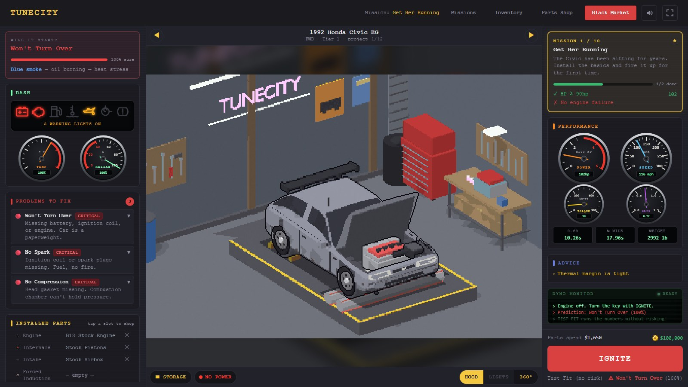
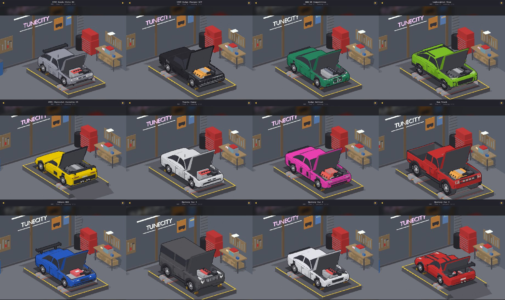
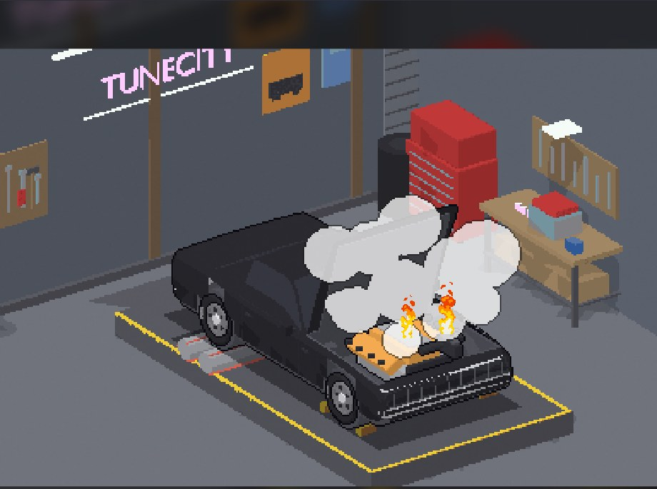
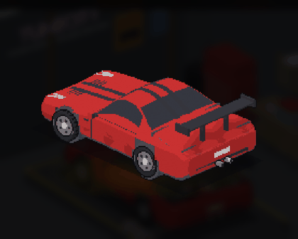
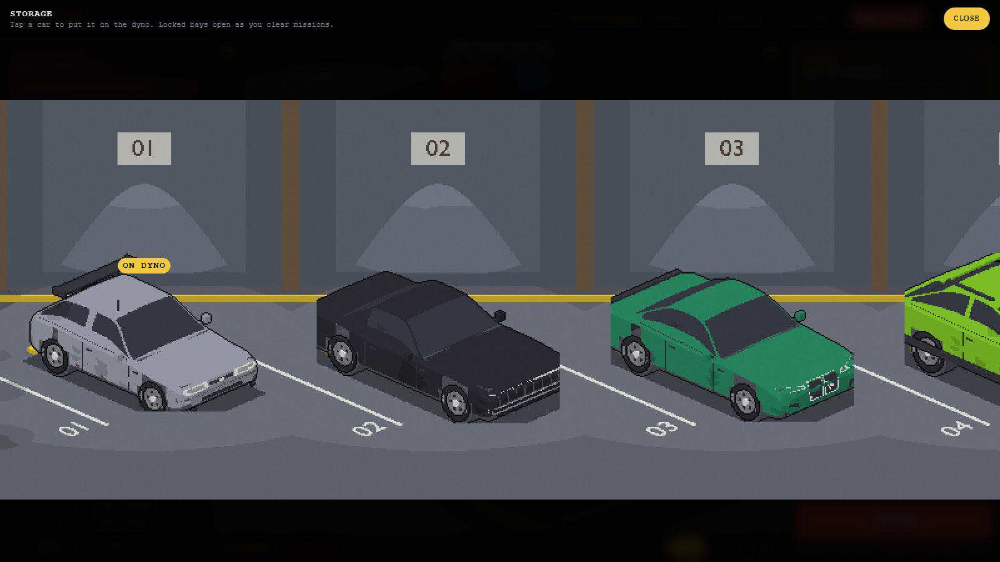
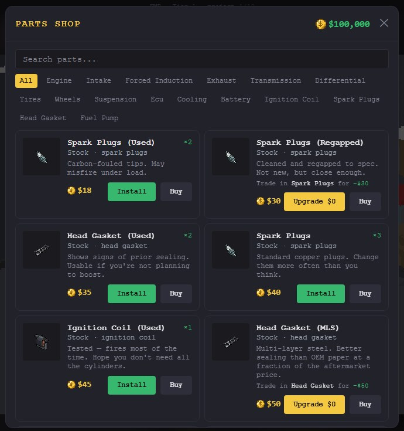
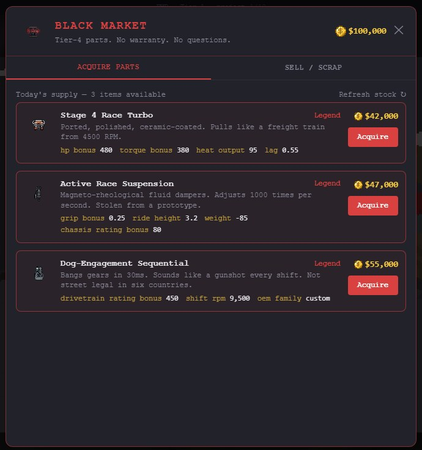

# TuneCity

A pixel-art browser game where you build, tune, and diagnose cars. No driving — pure constraint-satisfaction puzzle. Spec a build, fire the ignition, and see if your machine holds together.



https://youtu.be/RN81UVjhU4o

## Screenshots

**12 cars, each built in Blender and rendered as layered pixel-art states**: hood, engine, wheels, lights, smoke and every visible part are separate layers that change with what you install.



| Fire it up and see what breaks | Turn it round in the 360 view |
|---|---|
|  |  |

| Storage hall | Parts shop | Black Market |
|---|---|---|
|  |  |  |

## Stack

- **React 19** + **Vite 8**
- **Zustand** — game state with localStorage persistence
- **Supabase** — anonymous auth + cloud save sync (zero sign-up)
- **Framer Motion** — UI transitions and ignition sequence
- **Tailwind CSS v4**

## Getting Started

```bash
npm install
npm run dev
```

Open `http://localhost:5173`

```bash
npm test          # run engine unit tests once
npm run test:watch  # watch mode
npm run build     # production build
```

For itch.io, build one self-contained `index.html` (every sprite inlined, so it stays under itch's 1,000-file limit for HTML5 games) and zip `build/itch`:

```bash
BUILD_TARGET=itch npx vite build --outDir build/itch
```

## How It Works

1. **Pick a car** — each has base weight, grip, drag, and chassis/drivetrain limits
2. **Buy parts** from the shop or Black Market — organized by slot (engine, intake, forced induction, exhaust, etc.)
3. **Build diagnostic** — stats computed live: HP, torque, 0–60, top speed, quarter mile, reliability
4. **Fire ignition** — pass/fail based on reliability, heat output vs cooling capacity, and drivetrain stress
5. **Complete objectives** to unlock the Black Market and earn currency
6. **Sell or scrap** unwanted parts for currency (75% sell / 18% scrap)

## Economy

| Action | Value |
|---|---|
| Starting currency | $100,000 |
| Sell part | 75% of cost |
| Scrap part | 18% of cost |
| Mission rewards | $8k – $75k |

## Project Structure

```
src/
  assets/sprites/     PNG sprites + rotation frame folders
  components/         React UI (garage, shop, diagnostic, ignition, mission)
  data/               parts.json, cars.json, objectives.json, blackMarket.json
  engine/             Pure stat computation (computeStats, evaluateTags, resolveIgnition)
  stores/             Zustand slices (build, inventory, progress, ui, blackMarket)
  lib/                Supabase client + save sync hook
```

## Save Sync

On first visit an anonymous Supabase session is created and stored in `localStorage`. Game state is debounce-synced to the cloud every 2 seconds, keyed to the anonymous user ID. Switching devices loads the remote save automatically — no account required.

To enable: go to your Supabase project → **Authentication → Providers → Anonymous sign-ins → toggle on**.
